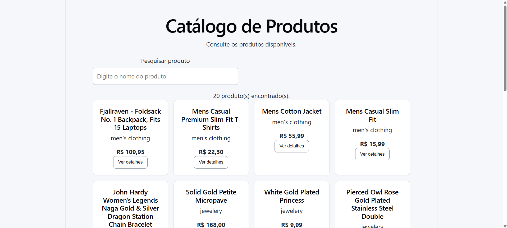
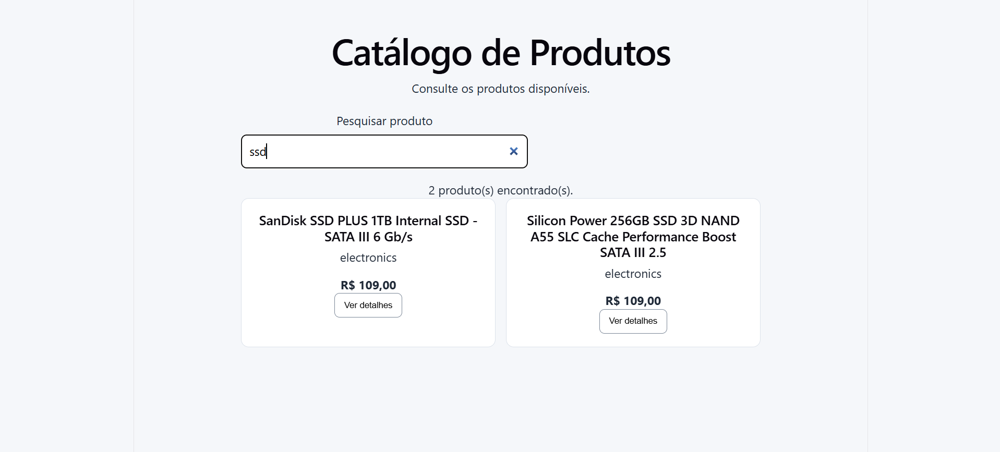
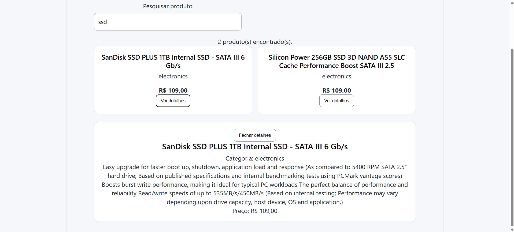

# Catálogo de Produtos

Aplicação desenvolvida com React e Vite para consultar, pesquisar e visualizar detalhes de produtos utilizando uma API REST.

## Pré-requisitos

- Node.js instalado
- npm instalado
- Navegador web

## Como executar o projeto

1. Clone o repositório:

   ```bash
   git clone URL_DO_REPOSITORIO
   ```

2. Entre na pasta do projeto:

   ```bash
   cd catalogo-produtos
   ```

3. Instale as dependências:

   ```bash
   npm install
   ```

4. Inicie a aplicação:

   ```bash
   npm run dev
   ```

5. Acesse o endereço local informado no terminal.  

## Árvore de componentes

```text
App
├── Header
├── ProductSearch
├── ProductList
│   └── ProductCard (repetido para cada produto)
└── ProductDetails (quando um produto é selecionado)
```

## Fluxo de dados entre os componentes

O componente `App` gerencia os estados da aplicação, incluindo os produtos, a pesquisa, o carregamento e os erros. O componente `ProductSearch` recebe o texto da pesquisa por meio de props e comunica as alterações ao `App` por meio de uma função callback. O `App` filtra os produtos e envia a lista resultante para `ProductList`. Esse componente utiliza `map` para percorrer a lista e renderizar um `ProductCard` para cada produto. Quando o usuário clica em “Ver detalhes”, o `ProductCard` chama uma função recebida por props, que atualiza o produto selecionado no `App`. O `App` consulta a API pelo identificador do produto e envia os dados para `ProductDetails`, que apresenta as informações e permite fechar o painel.

## Evidências dos testes manuais

### Teste 1 — Listagem de produtos

Verificação da exibição dos produtos carregados pela API.



### Teste 2 — Pesquisa

Verificação da pesquisa pelo título dos produtos.



### Teste 3 — Detalhes do produto



